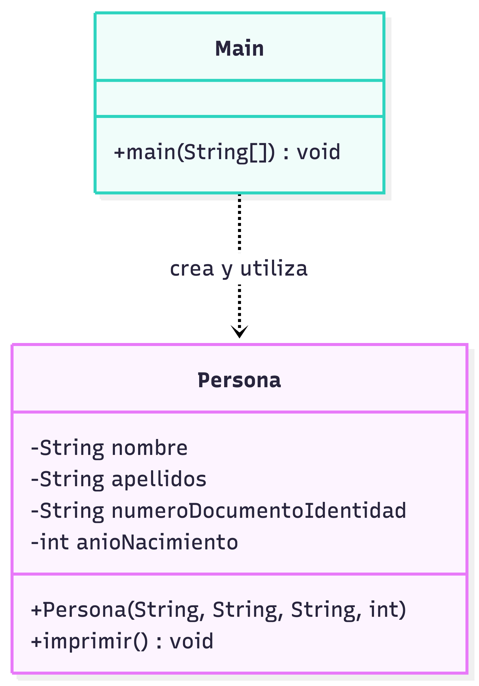

# Ejercicio 2.1 — Persona

Modela personas con nombre, apellidos, documento y año de nacimiento. `Main` crea e imprime dos objetos.

**Ejecutar:** abre `src/ejercicio21/Main.java` en IntelliJ IDEA y pulsa Run.

## Diagrama ULM:
