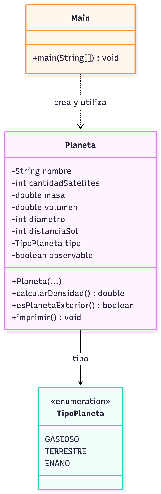

# Ejercicio 2.2 — Planeta

Define atributos de un planeta, un `enum` para su tipo, el cálculo de densidad y una comprobación de planeta exterior. La distancia al Sol se expresa en millones de kilómetros.

**Ejecutar:** abre `src/ejercicio22/Main.java` en IntelliJ IDEA y pulsa Run.

## Diagrama ULM:
