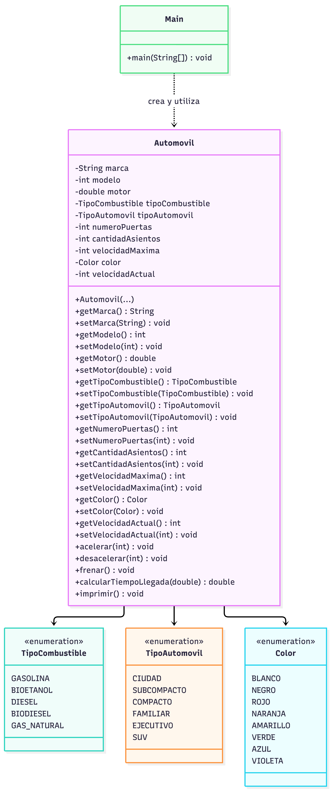

# Ejercicio 2.3 — Automóvil

Modela el automóvil con enumeraciones, métodos get/set, aceleración, desaceleración, frenado y cálculo del tiempo de recorrido a velocidad actual. El tiempo se devuelve en horas.

**Ejecutar:** abre `src/ejercicio23/Main.java` en IntelliJ IDEA y pulsa Run.

## Diagrama ULM:
