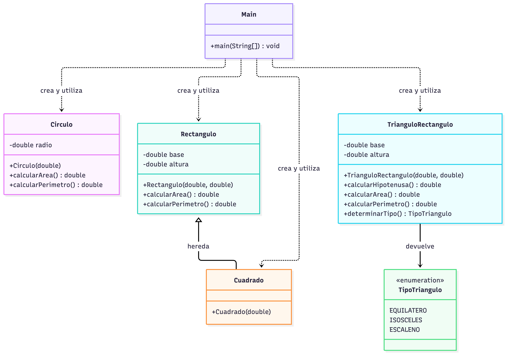

# Ejercicio 2.4 — Figuras geométricas

Calcula área y perímetro de círculo, rectángulo, cuadrado y triángulo rectángulo. Para este último también calcula la hipotenusa y clasifica los lados. En un triángulo rectángulo válido no se puede dar un triángulo equilátero; se conserva la clasificación solicitada por el enunciado y el método evalúa los lados calculados.

**Ejecutar:** abre `src/ejercicio24/Main.java` en IntelliJ IDEA y pulsa Run.

## Diagrama ULM:
