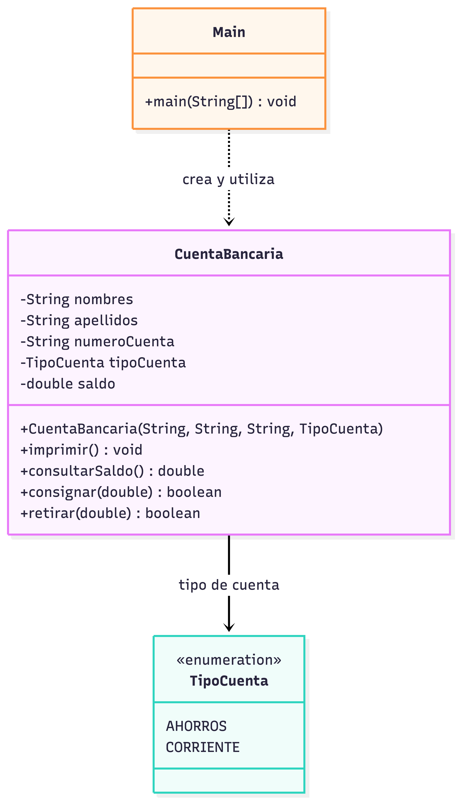

# Ejercicio 2.5 — Cuenta bancaria

Cuenta con titular, número, tipo (ahorros/corriente), saldo inicial cero, impresión, consulta, consignación y retiro. Las operaciones monetarias devuelven `true` si se completan y `false` si no cumplen las condiciones.

**Ejecutar:** abre `src/ejercicio25/Main.java` en IntelliJ IDEA y pulsa Run.

## Diagrama ULM:
